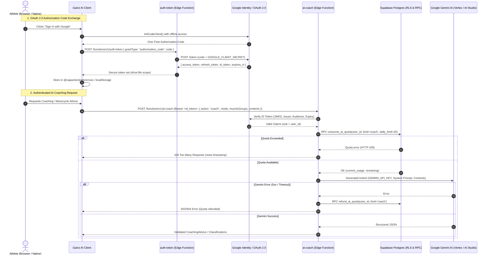

# ADR-0001: IT Security Architecture, Confidential Client OAuth 2.0 & Server-Side AI Gateway

- **Status**: Accepted
- **Date**: 2026-11-12
- **Deciders**: Principal AI Architect, Security & Infrastructure Review Board
- **Consulted**: Sports Science & Athlete Experience Team, Independent IT Security Reviewers

---

## 1. Context & Problem Statement

Gainz AI previously operated as a purely client-side Single Page Application (SPA). While this provided rapid initial prototyping, it introduced critical architectural and security vulnerabilities:

1. **Client-Side Bring-Your-Own-Key (BYOK) Risk**: Athletes were required to create and paste a Google Gemini API key into the app. The key was stored in plaintext within browser `localStorage` (`userProfile:apiKey`). This made keys vulnerable to Cross-Site Scripting (XSS), malicious extensions, device theft, and token scraping.
2. **Deprecated OAuth 2.0 Implicit Flow**: Google OAuth authentication relied on the client-side Implicit Flow (`google.accounts.oauth2.initTokenClient`). This flow did not provide refresh tokens (requiring frequent user re-login), exposed access tokens in browser memory, and has been deprecated by Google Identity Services in favor of the Authorization Code Flow with PKCE or confidential client exchange.
3. **Overly Broad OAuth Scopes**: The application previously requested `https://www.googleapis.com/auth/drive` (full Google Drive read/write access) and `https://www.googleapis.com/auth/spreadsheets`. This violated the Principle of Least Privilege and raised serious user trust and privacy barriers.
4. **Unregulated AI Calling & Denial-of-Wallet Risk**: Client-side execution of AI prompts allowed direct, unthrottled access to upstream LLM APIs, leaving the infrastructure vulnerable to cost amplification, quota exhaustion, and prompt manipulation.

A comprehensive IT security and architectural overhaul was required to transition Gainz AI into an enterprise-grade, secure, privacy-preserving application while maintaining offline resilience for athlete workouts.

---

## 2. Decision Drivers

- **Zero Client-Side Secrets**: Neither upstream AI API keys (`GEMINI_API_KEY`) nor OAuth client secrets (`GOOGLE_CLIENT_SECRET`) may ever be exposed to the client bundle, browser network inspection, or client storage.
- **Principle of Least Privilege**: Access to athlete Google accounts must be strictly restricted to files created or opened by Gainz AI.
- **Cryptographic User Identification**: All backend services must authenticate requests using verified cryptographic identity tokens (Google OIDC ID Tokens).
- **Abuse Prevention & Quota Control**: Usage must be metered per user and per platform with atomic database counters and automatic refunding on upstream failures.
- **Gym Offline Resilience**: Client-side route transitions and workout logging must remain 100% functional when disconnected from the internet.

---

## 3. Architectural Decision

We transitioned Gainz AI to a **Confidential Client & Edge Gateway Architecture** utilizing Supabase Edge Functions (`Deno.serve`) and managed PostgreSQL with Row-Level Security (RLS).

---

## 4. Key Security Controls & Mechanisms

### 4.1. OAuth 2.0 Authorization Code Flow & Scope Minimization
- **Confidential Code Exchange**: The client initiates `google.accounts.oauth2.initCodeClient` with `access_type: "offline"`. The resulting authorization code is exchanged server-side inside `auth-token` using the confidential `GOOGLE_CLIENT_SECRET`. The client never has access to the client secret.
- **Scope Restriction to `drive.file`**: Scopes are strictly narrowed to `https://www.googleapis.com/auth/drive.file`. The application cannot read, list, or modify any user files in Google Drive except for the specific workout spreadsheet created by or explicitly opened with Gainz AI. Full `drive` and deprecated `spreadsheets` scopes have been completely eliminated.
- **Secure Token Storage Abstraction**: Tokens are stored via `src/modules/auth/infrastructure/authStorage.ts`. On native platforms (iOS / Android Capacitor), tokens are stored in app-sandboxed native storage via `@capacitor/preferences` (`UserDefaults` / `SharedPreferences`, not hardware Keychain/Keystore). On web, scoped `localStorage` is used. Legacy plain-text keys (`userProfile:apiKey`, `apiKey`, `profile:apiKey`) are automatically scrubbed on startup (`purgeLegacyApiKeys`).

### 4.2. Google Caller Verification (OIDC ID Token & Access Token Fallback)
All calls to the `ai-coach` Edge Function require an `Authorization: Bearer <google_token>` header. The Edge Function validates the caller without trusting client-provided user IDs:
- **Primary Path (OIDC ID Token)**: If the bearer token is a 3-segment JWT, `verifyGoogleIdToken` fetches Google's live JSON Web Key Set (JWKS) from `https://www.googleapis.com/oauth2/v3/certs`, validates the RS256 signature, audience (`aud === GOOGLE_CLIENT_ID`), issuer (`iss === "accounts.google.com"` or `"https://accounts.google.com"`), and expiration (`exp > current_timestamp`). Invalid/expired 3-segment JWTs fail closed without falling back.
- **Fallback Path (OAuth Access Token)**: For opaque OAuth access tokens (for example, silent refresh flows when Google does not mint an `id_token`), `verifyGoogleAccessToken` validates the token via `POST https://oauth2.googleapis.com/tokeninfo` (`application/x-www-form-urlencoded` body with a 5s timeout) and confirms `aud === GOOGLE_CLIENT_ID` or `azp === GOOGLE_CLIENT_ID`.
- **Canonical Subject Extraction**: Extracts the immutable Google subject identifier (`sub`) from the verified token as the canonical `userId`.

### 4.3. Multi-Tiered Quota & Anti-Abuse Rate Limiting
To prevent denial-of-wallet and quota exhaustion:
- **Atomic Database RPC**: Daily usage is tracked in PostgreSQL via `consume_ai_quota(p_user_id, p_kind, p_daily_limit)`.
- **User-Level Cap**: Users are bounded to a fair-use limit of 25 coaching requests and 50 classification requests per UTC calendar day.
- **Global Platform Kill-Switch**: A global safety ceiling (`v_global_daily_cap = 10000` for coaching, `20000` for classification) prevents runaway platform billing in the event of distributed bot proliferation.
- **Atomic Upstream Refund (`refund_ai_quota`)**: If AI execution fails inside `executeAction` (for example upstream Gemini API errors, empty responses, or timeouts), the consumed quota slot is atomically refunded for the request's original UTC `usage_date` (`p_usage_date`).
- **Probabilistic 30-Day Retention Pruning**: Historical records older than 30 days are pruned probabilistically (`random() < 0.01`) during quota check transactions, eliminating hot-path index lock churn while maintaining GDPR data-retention compliance.

### 4.4. Input Hardening, Timeouts & Prompt Injection Guardrails
- **Payload Validation**: Inbound payloads to both Edge Functions are validated via strict TypeScript type guards (`isTokenRequestBody`, `isAiCoachRequestBody`), and client-side AI responses are schema-validated via Zod ACLs (`CoachingAdviceTranslator`) before entering domain state.
- **Aligned Timeout Hierarchy**: Client timeout margins (`65s` for planning, `48s` for follow-ups, `35s` for classification) are strictly longer than server-side Gemini execution timeouts (`55s`, `40s`, `30s`), guaranteeing that server quota refunds execute and return before client abort signals fire.
- **Length Bounds**: Exercise arrays are bounded to `0–100` items; coaching message parts are capped at `35,000` chars (`MAX_PART_TEXT_LENGTH`) and `50,000` chars total conversation length (`MAX_TOTAL_CONVERSATION_CHARS`), enforced identically in the client (`requestCoachingAdvice`) and Edge Function (`ai-coach`).
- **Multi-Turn Chat Compaction**: When assembling multi-turn history, `requestCoachingAdvice` compacts `previousMessages` to extract only prior user questions (`extractUserQuestion`), while sending the active turn's full assembled training context (`currentUserInput`).
- **Response Completeness & JSON Verification**: `ai-coach` rejects incomplete upstream `finishReason` values (`!== "STOP"`) and verifies `JSON.parse` completeness (after stripping markdown fences) before returning HTTP `200`, triggering upstream model fallback or atomic quota refund (`refund_ai_quota`) on truncated output.

### 4.5. Content Security Policy (CSP), Framing & Defense-in-Depth
- **CSP & Framing Headers (`index.html` & `public/_headers`)**:
  - `public/_headers` enforces `X-Frame-Options: DENY` and `Content-Security-Policy: frame-ancestors 'none'` on Cloudflare Pages responses to block clickjacking.
  - `index.html` CSP `connect-src`: Strictly limited to `'self'`, local dev & HMR ports (`ws:`, `wss:`, `http://localhost:*`, `http://127.0.0.1:*`), the Supabase project domain (`https://*.supabase.co`), Google Sheets/Drive APIs (`https://sheets.googleapis.com`, `https://*.googleapis.com`), Google OAuth endpoints (`https://accounts.google.com`, `https://oauth2.googleapis.com`, `https://www.googleapis.com`), and Sentry telemetry (`https://*.sentry.io`).
  - `script-src`: Restricts script execution to `'self'`, `'unsafe-inline'`, `data:` (needed for Vite's inline legacy/module detection scripts), and Google Identity Services (`https://accounts.google.com`, `https://apis.google.com`). `'unsafe-eval'` is omitted.
  - `frame-src`: Restricted to `'self'` and `https://accounts.google.com` for Google authentication iframes.
- **Database Row-Level Security (RLS)**:
  - Table `public.ai_daily_usage` has RLS enabled.
  - Direct public client access is completely blocked (`FOR ALL TO service_role USING (true)`).
  - Quota functions run with `SECURITY INVOKER`, an empty search path (`SET search_path = ''`) to eliminate search-path hijacking, and execution permissions granted exclusively to `service_role` (revoked from `public`, `anon`, and `authenticated`).
- **Rate-Limiting Defense In Depth**: `auth-token` enforces per-isolate token exchange rate-limiting (30 req/min per IP) as a baseline defense against local flooding, which can be backed by centralized Redis/PostgreSQL if targeted distributed abuse arises.
- **Telemetry Sanitization**: Sentry `beforeSend` in `src/main.ts` drops `user` PII, strips sensitive request headers (`authorization`, `cookie`, `x-api-key`), and redacts `access_token` / `id_token` / `code` query parameters before events leave the client.

---

## 5. Consequences

### Positive Consequences
- **User Trust & Privacy**: Users no longer need to trust the app with their personal Gemini API keys or grant wide Google Drive permissions.
- **Complete Elimination of Client Secrets**: `GOOGLE_CLIENT_SECRET` and `GEMINI_API_KEY` are isolated in Supabase vault secrets (`Deno.env`).
- **Robust Background Refresh**: Refresh tokens enable seamless session continuation without disruptive authentication prompts.
- **Fair-Use Protection**: Cost and upstream rate limits are enforced at the database level.
- **Gym Offline Usability**: The client router does not execute blocking network token checks during tab navigation, preserving instant offline responsiveness.

### Negative Consequences / Trade-Offs
- **Backend Dependency**: The application now depends on Supabase Edge Functions and PostgreSQL availability for authentication and AI features (logging workouts to local storage remains offline-capable).
- **Cold Start Latency**: Supabase Edge Functions incur an initial cold start latency (~200–300ms) on idle invocations.

---

## 6. References & Compliance

- [Google Identity Services: Migration from Implicit Flow to Code Flow](https://developers.google.com/identity/gsi/web/guides/migration)
- [Google Drive API Scopes & Least Privilege (`drive.file`)](https://developers.google.com/drive/api/guides/api-specific-auth)
- [RFC 6749: The OAuth 2.0 Authorization Framework](https://datatracker.ietf.org/doc/html/rfc6749)
- [RFC 7519: JSON Web Token (JWT) & OpenID Connect Core 1.0](https://openid.net/specs/openid-connect-core-1_0.html)
- Related Architecture Boundary Tests: `src/modules/architecture.boundaries.test.ts`
- Edge Function Implementations: `supabase/functions/ai-coach/index.ts`, `supabase/functions/auth-token/index.ts`
- Database Migrations: `supabase/migrations/20261111165942_create_ai_daily_usage_and_quota_rpc.sql`, `supabase/migrations/20261111170047_add_service_role_policy_on_ai_daily_usage.sql`, `supabase/migrations/20261111191000_create_refund_ai_quota_rpc.sql`, `supabase/migrations/20261111221000_add_retention_prune_to_consume_quota.sql`, `supabase/migrations/20261112070000_add_usage_date_index_and_global_cap.sql`, `supabase/migrations/20261113171000_add_refund_usage_date_and_global_cap_flag.sql`
